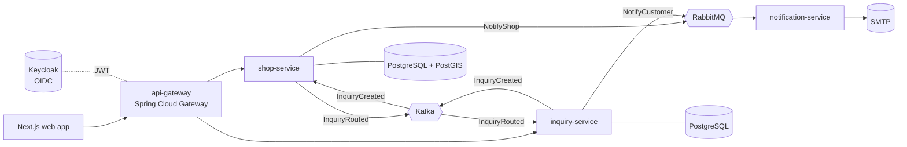

# PartRadar

> Find the car part you need — in stock, in a shop near you, today.

[](https://github.com/utku-kucuk/partradar/actions/workflows/backend.yml)
[](https://github.com/utku-kucuk/partradar/actions/workflows/frontend.yml)
[](https://github.com/utku-kucuk/partradar/actions/workflows/codeql.yml)
[](LICENSE)

PartRadar connects drivers and independent mechanics with **physical auto-parts shops and repair services nearby**.
A user describes the vehicle and the part once; the request is routed to the most relevant nearby shops, and they reply
with availability, price and delivery time.

> **Status:** proof of concept running on demo data, under active development. See the [roadmap](#roadmap).

## Why I built this
PartRadar is my own idea, and it targets a real, everyday problem rather than a tutorial scenario.

When a car is in the garage waiting for a part, the usual way to find it is to phone shops one by one or walk
around the industrial zone. Online stores ship by cargo and cannot say what is on a shelf two streets away
**right now**. Meanwhile local shops answer the same phone questions all day and have no idea how much demand they miss.
I wanted to see whether a small, well-engineered system could close that gap: one request in, real quotes from nearby
shops out, in minutes instead of hours.

## Problem
- There is no digital way to know which nearby shop has a part **in stock right now**; same-day local stock is invisible.
- Fitment, fair price and which mechanic really knows a job are opaque. Reviews are not tied to a real, completed job.
- Local shops have weak digital visibility, answer the same calls repeatedly and cannot measure lost demand.

## Solution — phased
| Phase | Capability | Status |
|---|---|---|
| 1 | **Part inquiry:** vehicle + part → routed to nearby shops → quotes (available, price, ETA) | in progress |
| 2 | **Shop panel & inventory:** inbox, stock built from answered requests, analytics | planned |
| 3 | **Verified jobs:** jobs confirmed with a one-time code / QR; only verified jobs can be reviewed | planned |

## Architecture
Event-driven microservices on Kubernetes. Every significant decision is recorded as an [ADR](docs/adr).



| Service | Responsibility |
|---|---|
| `api-gateway` | Single entry point: JWT validation, routing, timeouts, circuit breakers |
| `shop-service` | Shops and locations; finds the best nearby shops for an inquiry (PostGIS) |
| `inquiry-service` | Inquiries and quotes, their lifecycle and expiry |
| `notification-service` | E-mail delivery with retries and a dead-letter queue |

**Key design choices**
- **Database per service**, no shared tables. State changes and events are committed together via a **transactional outbox**.
- **Kafka** for domain events (ordered per inquiry, replayable); **RabbitMQ** for notification commands
  (acknowledged work queue, delayed retries, DLQ) — see [ADR-0005](docs/adr/0005-kafka-and-rabbitmq.md).
- **Idempotent consumers**, so at-least-once delivery never creates duplicate quotes or e-mails.
- **Distributed tracing** with OpenTelemetry across HTTP, Kafka and RabbitMQ.

## Tech stack
**Backend:** Java 25, Spring Boot 4, Spring Cloud Gateway, Spring Security (OAuth2 resource server), Spring Data JPA,
Spring Kafka, Spring AMQP, Resilience4j, Flyway, PostgreSQL + PostGIS, OpenAPI
**Messaging:** Apache Kafka (KRaft), RabbitMQ
**Identity:** Keycloak
**Frontend:** Next.js, TypeScript, Tailwind CSS
**Quality:** JUnit 5, Testcontainers, ArchUnit, Spotless, JaCoCo, CodeQL
**Platform:** Docker, Kubernetes, Helm, kind, Strimzi, RabbitMQ Cluster Operator, CloudNativePG, GitHub Actions, GHCR
**Observability:** OpenTelemetry, Prometheus, Grafana, Loki, Tempo

## Repository layout
```
partradar/
├── services/            api-gateway · shop-service · inquiry-service · notification-service
├── libs/                platform-common (error handling, security, messaging helpers)
├── frontend/            Next.js web app
├── deploy/
│   ├── compose/         local infrastructure for development
│   ├── helm/            umbrella chart + service library chart
│   └── kind/            local Kubernetes cluster
├── docs/                ADRs, architecture diagrams, AsyncAPI contracts
└── e2e/                 end-to-end API tests
```

## Roadmap
- [x] Repository, CI, code scanning and release automation
- [x] Architecture decisions (microservices, messaging, Kubernetes)
- [ ] Multi-module build and service skeletons
- [ ] Local infrastructure with Docker Compose
- [ ] Shops and nearby search
- [ ] Inquiries, quotes and outbox to Kafka
- [ ] Routing inquiries to nearby shops
- [ ] Notifications over RabbitMQ with retries and DLQ
- [ ] Gateway with Keycloak and resilience
- [ ] Observability
- [ ] Helm charts, kind cluster and end-to-end tests in CI
- [ ] Web app flows
- [ ] `v0.1.0`

## Getting started
_Coming with the first service milestone._ The full system will start locally with `make k8s-up`.

## Contributing
See [CONTRIBUTING.md](CONTRIBUTING.md). Commits follow [Conventional Commits](https://www.conventionalcommits.org);
releases and the changelog are generated by release-please.

## License
[MIT](LICENSE)

---

## Türkçe özet
**PartRadar**, kendi fikrim olan ve gerçek bir günlük sorunu çözmeyi hedefleyen bir projedir: araç sanayide beklerken
gereken parçanın **yakındaki hangi dükkânda şu an stokta** olduğunu bulmak. Kullanıcı aracı ve parçayı bir kez tarif eder;
talep en uygun yakın dükkânlara yönlendirilir, dükkânlar stok, fiyat ve teslim süresiyle teklif verir.

Teknik olarak Java 25 / Spring Boot 4 ile yazılmış, Kafka (domain event'leri) ve RabbitMQ (bildirim komutları, retry/DLQ)
kullanan, Kubernetes üzerinde Helm ile çalışan, event-driven bir microservices sistemidir. Mimari kararlar
[`docs/adr`](docs/adr) altında gerekçeleriyle belgelenmiştir.
